这个作业属于哪个课程：[首页 - 2026高级语言程序设计 - 福州大学 - 班级博客 - 博客园](https://edu.cnblogs.com/campus/fzu/2026gjyycxsj)

这个作业要求在哪里：[高级语言程序设计课程第二次个人作业 - 作业 - 2026高级语言程序设计 - 班级博客 - 博客园](https://edu.cnblogs.com/campus/fzu/2026gjyycxsj/homework/16748)

学号：052402239

姓名：陈逸轩

---

## 一、3.11 T1~T8

编写并运行书本第3章3.11 编程练习题目中的第1题\~第8题。

### 1、3.11.1

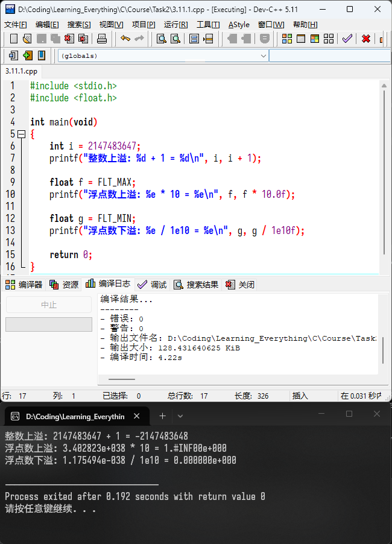

### 2、3.11.2

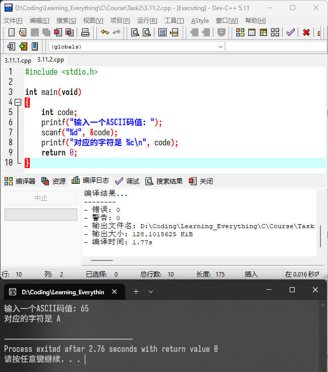

### 3、3.11.3

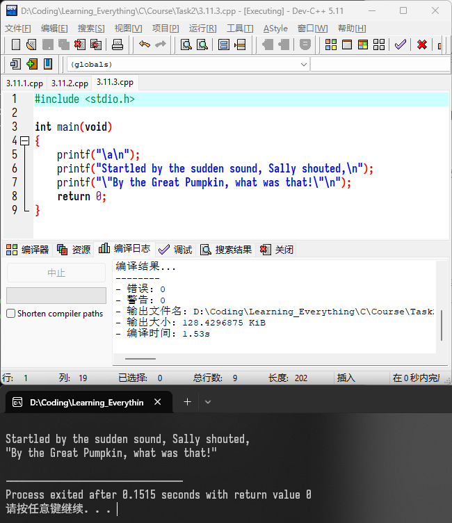

### 4、3.11.4

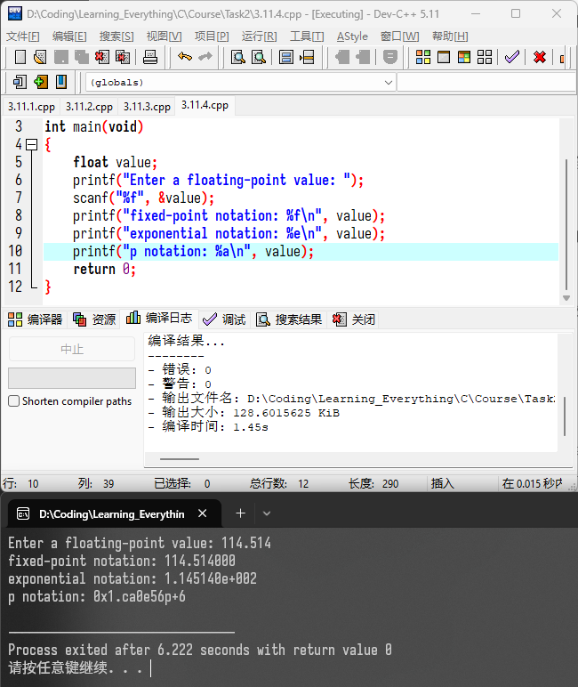

### 5、3.11.5

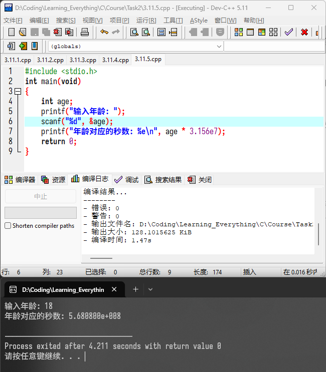

### 6、3.11.6

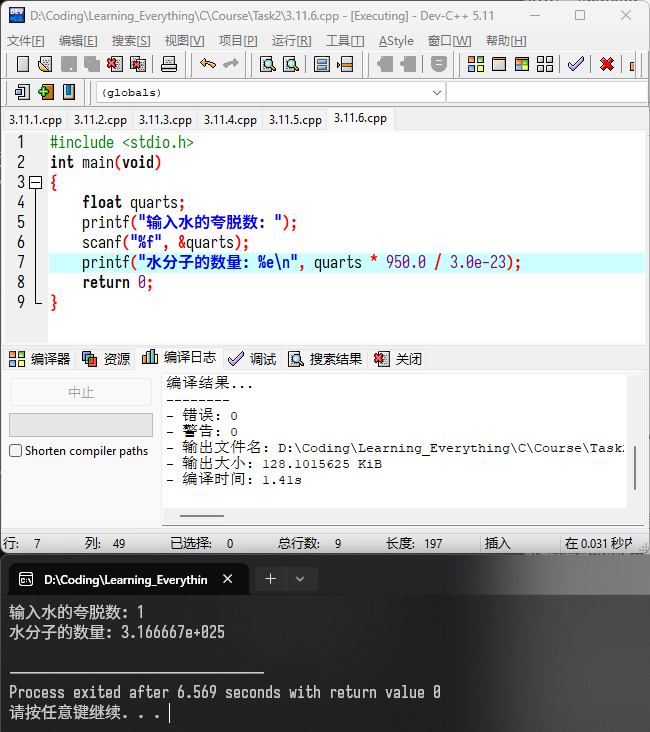

### 7、3.11.7

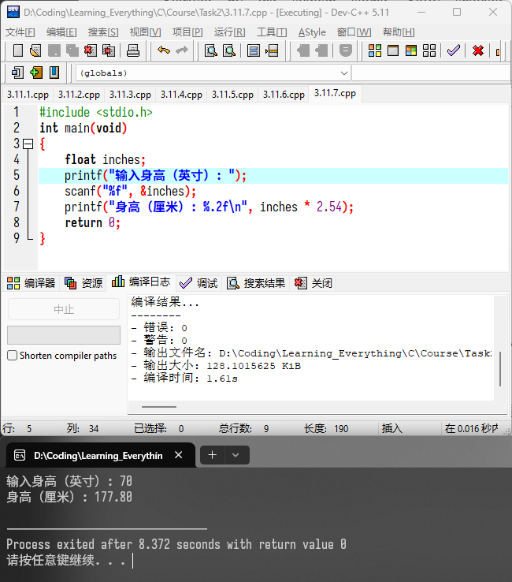

### 8、3.11.8

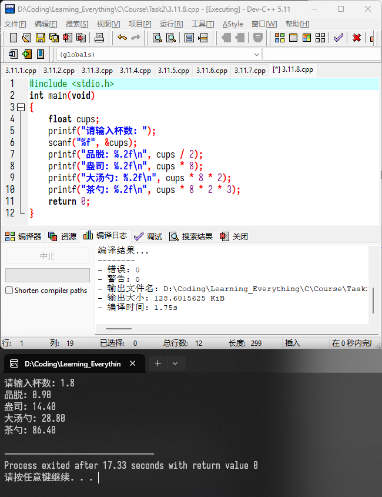

## 二、程序清单 3.1~3.5, 3.8~3.9 示例程序

将书本中给的程序清单 3.1~3.5, 3.8~3.9 的示例程序结果输出（无需代码，截图程序输出结果）。

### 1、3.1\_platinum.c

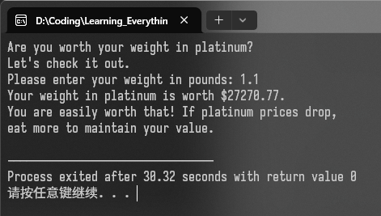

### 2、3.2_print1.c

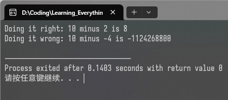

### 3、3.3_bases.c

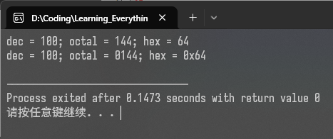

### 4、3.4_print2.c

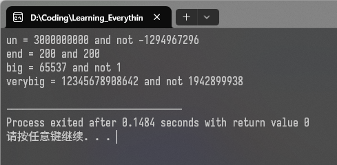

### 5、3.5_charcode.c

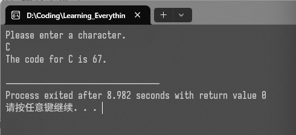

### 6、3.8_typesize.c

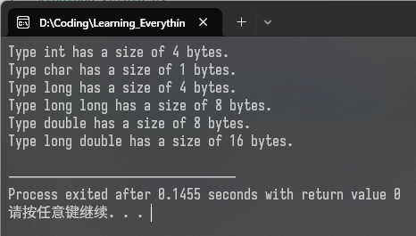

### 7、3.9_badcount.c

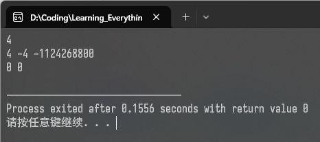

## 三、给定程序运行结果

运行以下程序给出程序结果（无需代码，截图程序输出结果，如有错误可自行修改）。

### 1、

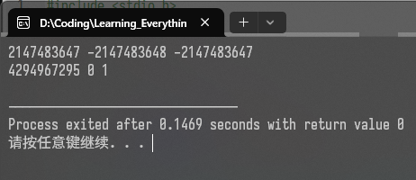

### 2、

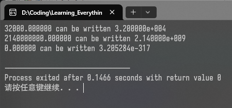

### 3、

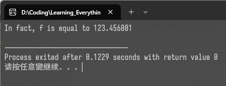

### 4、

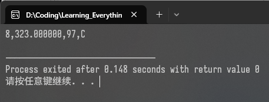

### 5、

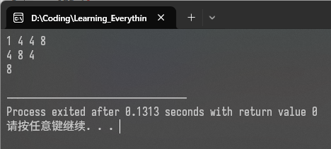

## 四、程序设计

设计一个程序完成以下内容的不同形式输出。

（1）按小数形式输出实数：%f 由系统指定宽度（6位小数）， %m.nf 指定宽度m，小数位数n，右靠齐， %-m.nf 指定宽度m，小数位数n，左靠齐 （注意：宽度包括符号和小数点）。

（2）用于输出字符串：%s 不指定宽度， %-ms 指定宽度，左靠齐， %ms 指定宽度，右靠齐， %m.ns 指定宽度m，只取左端n个字符， 右靠齐， %-m.ns 指定宽度m，只取左端n个字符， 左靠齐。

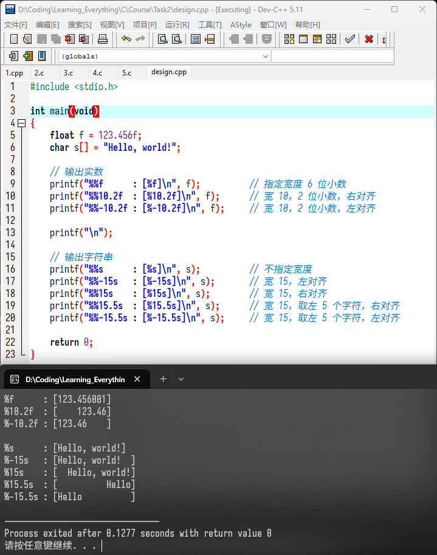

## 五、总结与思考

这次作业中，我完成了一些C语言编程题目的编写与执行。

- 浮点数有舍入误差，不能用 `==` 直接进行比较，应比较差值是否小于容差 `fabs(a - b) < eps`;
- `float` 加 `f` 后缀，避免 `double` 变为 `float` 的隐式截断
- 混合运算提升，最终取 “等级最高”的类型：`int + float → float`，`float + double → double`，

我想到：软件工程是一门有意思的好学科。
